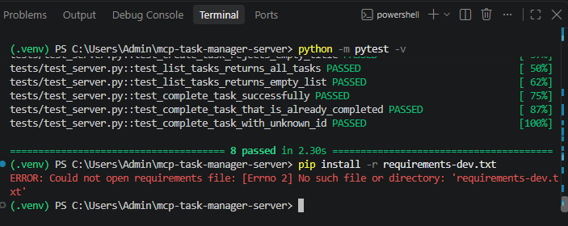
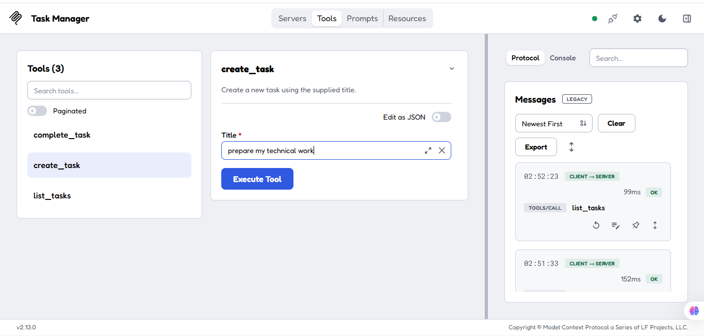
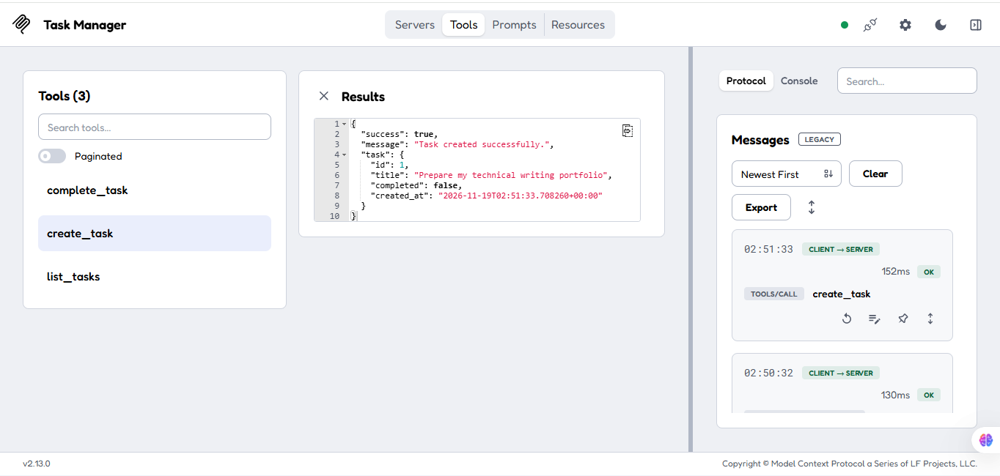
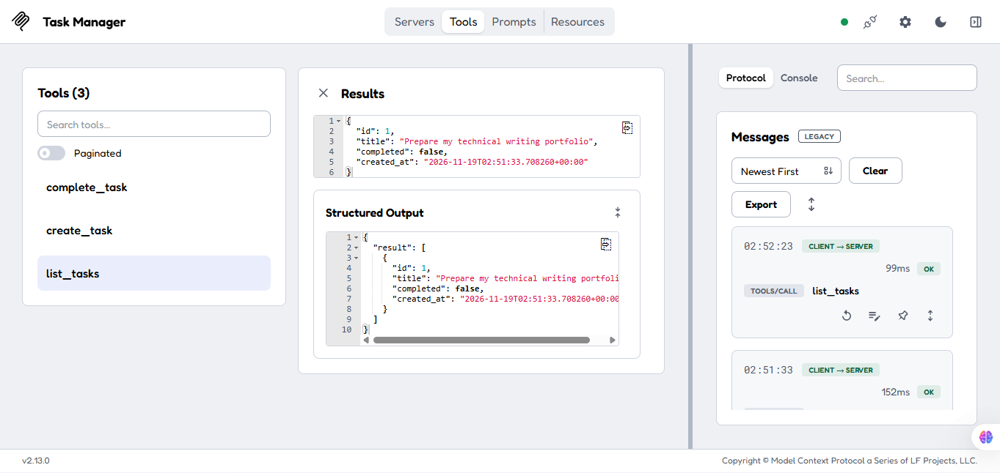

# I Built an MCP Server for Task Management. Here's What I Learned About Giving AI Agents Tools.

## Introduction

I wanted to understand how MCP servers work beyond reading about the Model Context Protocol. More importantly, I wanted to explore how AI agents could interact with external tools and use them to perform specific tasks.

Rather than approach this purely from a theoretical perspective, I decided to build something practical.

That decision led me to develop a task-management server using Python and the Model Context Protocol (MCP).

The idea was straightforward: create a server that exposes task-management operations as tools that an MCP-compatible client can discover and invoke.

The server would support three operations: creating a task, retrieving existing tasks, and marking tasks as completed.

Although the project was relatively small, building it introduced me to several important concepts, including tool definitions, input validation, application state, error handling, and automated testing.

In this article, I'll walk through what I built, the technical decisions behind the implementation, how I tested the server, the problems I encountered, and what the experience taught me about building tools for AI applications.

## Understanding MCP and the Problem I Wanted to Solve

AI models can generate responses, explain concepts, and reason through instructions. However, interacting with external systems requires more than generating text. An AI application needs a way to access tools and services that can perform specific operations.

This is where the Model Context Protocol (MCP) becomes relevant.

MCP is an open protocol that provides a standardised way for AI applications to communicate with external tools and data sources through MCP servers.

Instead of building a separate integration for every AI application and every tool, developers can use MCP to establish a consistent communication interface.

An MCP server can expose capabilities such as tools, resources, and prompts. In this project, I focused specifically on tools.

Tools are functions that an MCP client can discover and invoke when appropriate. For example, a task-management server could expose a tool for creating a task, another for retrieving tasks, and another for marking a task as completed.

I wanted to understand this interaction in practice.

Rather than build a complex integration, I chose a small task manager as my starting point. It offered a manageable way to explore how tools are defined, how arguments are passed, how results are returned, and how errors are handled.

The goal was not to build a complete productivity application. It was to understand the process of exposing useful functionality through an MCP server.

## What I Built

I built a Python-based MCP server called **Task Manager**.

It exposes three tools:

| Tool | Function |
|---|---|
| `create_task` | Creates a task using a supplied title |
| `list_tasks` | Retrieves all tasks currently stored |
| `complete_task` | Marks a task as completed using its ID |

I used the MCP Python SDK 2.x and Python's built-in data structures to implement the task-management logic.

For storage, I chose an in-memory list rather than introducing a database. This kept the project focused on the MCP implementation itself.

The result was a small server with clearly defined capabilities that I could test through MCP Inspector.

## Implementing the MCP Task Manager with Python

Once I had settled on the scope of the project, I started by setting up the server and defining the data structure that would represent each task.

### 1. Setting up the server

I started with the necessary Python imports:

```python
from dataclasses import asdict, dataclass
from datetime import datetime, timezone
from itertools import count

from mcp.server import MCPServer
```

Each import serves a specific purpose:

- `dataclass` provides a convenient way to define the structure of a task.
- `asdict` converts task objects into dictionaries.
- `datetime` and `timezone` generate timestamps using UTC.
- `count` generates sequential task IDs.
- `MCPServer` is used to initialise the server.

I then created the server instance:

```python
mcp = MCPServer("Task Manager")
```

This gives the server its name: `Task Manager`.

### 2. Defining the task structure

Before implementing the tools, I needed a consistent structure for the data they would create and retrieve.

I used a Python dataclass:

```python
@dataclass
class Task:
    id: int
    title: str
    completed: bool
    created_at: str
```

Every task contains four fields:

| Field | Purpose |
|---|---|
| `id` | A unique sequential identifier |
| `title` | The task description |
| `completed` | A Boolean indicating whether the task is complete |
| `created_at` | The date and time the task was created |

Using a dataclass kept the task representation simple and readable.

### 3. Managing task data in memory

For the first version, I chose an in-memory Python list:

```python
tasks: list[Task] = []
task_id_counter = count(1)
```

The `tasks` list holds task objects while the server is running. The `count(1)` iterator generates sequential IDs whenever a new task is created.

This was a deliberate trade-off. A database would have introduced additional configuration and implementation work. Since my immediate goal was to understand MCP tool definitions and client interactions, an in-memory list was sufficient.

However, this choice has an important limitation: tasks are not persistent. When the server process stops, the list is cleared, and previously created tasks are lost.

### 4. Exposing the task-management tools

With the server and data structure in place, I implemented three tools. I used the `@mcp.tool()` decorator to register each function.

#### Creating a task

```python
@mcp.tool()
def create_task(title: str) -> dict:
    """Create a new task using the supplied title."""

    if not title.strip():
        raise ValueError("Task title cannot be empty.")

    task = Task(
        id=next(task_id_counter),
        title=title.strip(),
        completed=False,
        created_at=datetime.now(timezone.utc).isoformat(),
    )

    tasks.append(task)

    return {
        "success": True,
        "message": "Task created successfully.",
        "task": asdict(task),
    }
```

The function first validates the supplied title. Calling `strip()` removes leading and trailing whitespace, while the condition prevents an empty string or whitespace-only input from being accepted.

It then creates a task with a generated ID, an initial completion status of `False`, and a UTC timestamp.

Finally, the task is appended to the list and returned as a dictionary.

I used `asdict()` to convert the dataclass instance into a dictionary before returning it. This provides a structured result rather than exposing a raw Python object.

#### Listing all tasks

```python
@mcp.tool()
def list_tasks() -> list[dict]:
    """Retrieve all tasks stored in the task manager."""

    return [asdict(task) for task in tasks]
```

This function retrieves every task currently stored in memory and converts each one into a dictionary.

If no tasks have been created, it naturally returns an empty list.

#### Completing a task

```python
@mcp.tool()
def complete_task(task_id: int) -> dict:
    """Mark a task as completed using its ID."""

    for task in tasks:
        if task.id == task_id:
            if task.completed:
                return {
                    "success": True,
                    "message": "Task is already completed.",
                    "task": asdict(task),
                }

            task.completed = True

            return {
                "success": True,
                "message": "Task completed successfully.",
                "task": asdict(task),
            }

    raise ValueError(f"Task with ID {task_id} was not found.")
```

This function searches for a task with the supplied ID.

It handles three possible outcomes:

1. If the task exists and is not completed, it updates the `completed` field to `True`.
2. If the task is already completed, it returns a message explaining that no further update was necessary.
3. If the task ID does not exist, it raises a `ValueError`.

I considered the second case important because a tool should communicate what actually happened, rather than returning the same generic response regardless of the task's state.

### 5. Bringing the implementation together

The server now had three registered tools with clearly defined responsibilities:

| Tool | Input | Responsibility |
|---|---|---|
| `create_task` | `title` | Creates and stores a new task |
| `list_tasks` | None | Returns all stored tasks |
| `complete_task` | `task_id` | Marks a matching task as completed |

The implementation follows a simple structure: define the data, maintain the state, and expose specific operations through MCP tools.

This gave me a practical starting point for exploring how an MCP client could interact with functionality defined on a server.

## Testing the MCP Server

After implementing the three tools, I needed to verify that they worked as expected.

I approached testing in two ways:

- Automated testing with `pytest`.
- Manual interaction through MCP Inspector.

These approaches served different purposes. Automated tests helped me verify the functions' behaviour consistently, while MCP Inspector allowed me to interact with the server through an MCP client interface.

### 1. Automated testing with pytest

I used `pytest` to test the server's core functionality.

Rather than testing only successful operations, I included cases where the server received invalid input or encountered unexpected conditions.

The test suite covered eight scenarios:

| Test scenario | Expected behaviour |
|---|---|
| Create a task | A task is created with the expected fields |
| Trim task title | Leading and trailing whitespace is removed |
| Reject an empty title | A `ValueError` is raised |
| List all tasks | Existing tasks are returned |
| List an empty task list | An empty list is returned |
| Complete a task | The matching task is marked as completed |
| Complete an already-completed task | An appropriate message is returned |
| Complete an unknown task ID | A `ValueError` is raised |

I ran the tests from the project root using:

```powershell
python -m pytest -v
```

The `-v` flag enabled verbose output, making it easier to identify individual tests and their results.

All eight tests passed.




*All eight automated tests passed successfully.*

This was an important checkpoint. It gave me confidence that the core task-management logic behaved as intended before moving on to testing the server through an MCP client.

### 2. Interacting with the server through MCP Inspector

Automated tests were useful, but they did not replace the need to interact with the server through an MCP client.

For this, I used MCP Inspector.

I started the development interface from the project directory with:

```powershell
mcp dev server.py
```

This allowed me to launch the server in the development environment and access MCP Inspector to interact with its exposed tools.

Through the Inspector, I could examine the available tools and provide arguments to invoke them.

I tested the task-management operations by creating tasks, retrieving the task list, and marking tasks as completed.

This gave me a more practical understanding of the client-server interaction: the functions I had written in Python were exposed as tools that an MCP-compatible client could interact with.




*The three task management tools registered with the MCP server.*



*The three task management tools registered with the MCP server.*



*A task created successfully through the MCP Inspector.*

Using both testing approaches helped me examine the project from two perspectives: whether the underlying Python functions behaved correctly and whether the tools were accessible through the MCP development interface.

## Technical Challenges and How I Resolved Them

Building the server was only part of the learning experience. I also encountered a few environment and tooling problems along the way.

Some of these issues were not caused by the task-management logic itself. They came from the development environment, Python's module resolution, and project configuration.

Here are the problems that stood out.

### 1. The `uv` command was not recognised

When I first tried to launch the MCP development interface, I encountered an error indicating that `uv` was not recognised as a command.

This was a tooling issue rather than a problem with the server implementation.

The development workflow depended on `uv`, but it was not available in my environment.

I resolved this by installing it through Python's package manager:

```powershell
python -m pip install uv
```

I then checked that the installation was successful:

```powershell
uv --version
```

After confirming that the command was available, I retried:

```powershell
mcp dev server.py
```

**What I learned:** Installing a Python package does not automatically mean every command-line dependency required by a development workflow is available. It is important to identify whether an error comes from the application code or the surrounding tooling.

### 2. Pytest could not find the server module

Another issue appeared when I ran the tests directly.

I encountered:

```text
ModuleNotFoundError: No module named 'server'
```

The problem was related to how Python resolved the module when the tests were executed.

My project had a root-level `server.py` file and a separate `tests` directory. Running the test command in the wrong context could affect how Python located the module.

I resolved this by running pytest as a Python module from the project root:

```powershell
python -m pytest -v
```

This ensured that the current project directory was included in Python's module search path.

**What I learned:** The directory from which a Python command is executed can affect module imports and test discovery. When working with Python projects, it is worth checking the current working directory before changing application code to fix an import error.

### 3. The development requirements file was missing

At one point, I attempted to install the development dependencies:

```powershell
pip install -r requirements-dev.txt
```

But the terminal returned:

```text
ERROR: Could not open requirements file:
[Errno 2] No such file or directory: 'requirements-dev.txt'
```

The issue was straightforward: the file did not exist in the project directory at that point.

I created `requirements-dev.txt` in the project root and added:

```text
-r requirements.txt
pytest>=8
```

This allowed the development requirements file to include the main project dependencies while adding pytest for testing.

I then reran the installation command and executed the tests again. The installation worked, and all eight tests passed.

**What I learned:** Dependency management is part of making a project reproducible. A project should clearly distinguish between the packages required to run the application and those needed for development and testing.

### 4. Accidentally creating a nested project directory

I also encountered a Git-related issue while organising and pushing the project to GitHub.

During the process, I ended up with an unintended nested project directory. This made the folder structure different from the one I intended to maintain.

I had to inspect the directories, identify where the actual project files were, and restore the intended structure before continuing with Git operations.

**What I learned:** Git commands operate relative to the current repository and working directory. Before cloning, copying, or committing files, it is worth checking the current directory and confirming that the repository structure is correct.

These experiences reminded me that building software involves more than writing functions. Understanding the development environment, dependency configuration, testing workflow, and version control process is equally important.

## What I Learned from Building an MCP Server

Beyond getting the project to work, the experience helped me understand several concepts more clearly.

### 1. Tools need clear responsibilities

Each of the three tools has one primary responsibility.

`create_task` creates a task, `list_tasks` retrieves tasks, and `complete_task` updates a task's completion status.

Keeping these responsibilities separate made the implementation easier to understand and test.

It also reinforced an important idea: a tool exposed to an AI application should have a clear purpose and predictable behaviour.

### 2. Input validation matters

A tool may be invoked with incomplete, invalid, or unexpected input.

The title validation in `create_task` and the missing-task check in `complete_task` helped me think about how tools should handle these situations.

A useful tool should not simply accept every input. It should define what it expects and communicate when those expectations are not met.

### 3. State management affects reliability

Using an in-memory list made the project easier to implement, but it also exposed a limitation.

The server cannot retain tasks after its process stops.

This helped me understand that tool functionality and data persistence are separate concerns. A tool can work correctly while still relying on storage that is unsuitable for a production application.

### 4. Testing should cover more than the happy path

The eight passing tests gave me a way to verify normal behaviour and edge cases.

Testing empty titles, unknown task IDs, and repeated completion requests was particularly useful.

It reinforced the importance of checking not only what happens when everything goes right, but also how an application responds when something goes wrong.

### 5. MCP is about exposing capabilities through a common interface

One of my biggest takeaways was understanding the difference between writing an ordinary Python function and exposing that function as an MCP tool.

The functions contain the actual task-management logic. The MCP server makes those capabilities available through a protocol that compatible clients can use.

That distinction helped me understand the role MCP plays in connecting AI applications with external functionality.

## Limitations and What I Would Improve

The project was intentionally small, so there are several areas I would improve in a future version.

**Persistent storage:** The current implementation stores tasks in a Python list. I would introduce SQLite or another database so tasks remain available after the server restarts.

**Additional task operations:** I would add tools for editing and deleting tasks to make the task manager more useful.

**Improved input validation:** I would consider additional validation for task IDs and titles, along with more structured error responses.

**Integration with an AI application:** I tested the server through MCP Inspector. A logical next step would be connecting it to an MCP-compatible AI application and observing how the application discovers and uses the tools in response to user requests.

These improvements would move the project beyond a learning exercise towards a more complete task-management service.

## Conclusion

Building this MCP task manager gave me a practical way to explore the Model Context Protocol.

I started with a simple question: how can an AI application interact with functionality outside its own environment?

By implementing three tools, managing task state, writing automated tests, and using MCP Inspector, I gained a better understanding of how an MCP server exposes capabilities to compatible clients.

The project also taught me that small implementations can reveal important engineering lessons. Tool design, input validation, error handling, dependency management, and testing all contribute to building reliable integrations.

I still have improvements I would like to make, particularly around persistent storage and connecting the server to an AI application.

But the most valuable part of this experience was moving from reading about MCP to building something that uses it.

**The code is available on GitHub:** [MCP Task Manager Server](https://github.com/BrownIbifuro/mcp-task-manager-server).

If you're learning about MCP too, I'd be interested to hear what you're building and what you've discovered along the way.